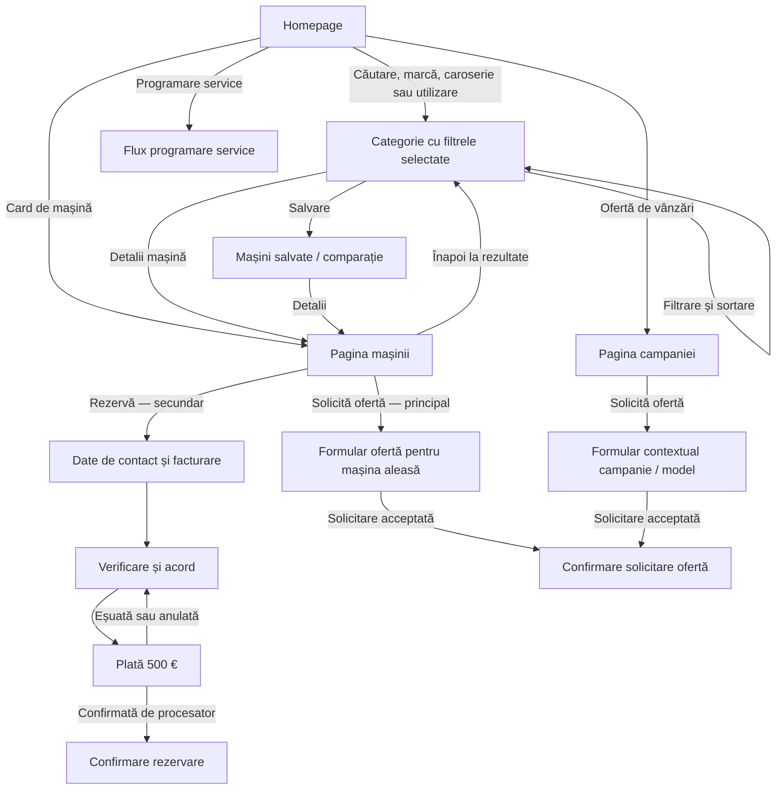

# Autoklass — structura UX pentru implementare

Versiune de lucru · 2 octombrie 2026 · Homepage, categorie și pagina mașinii

Documentul explică ordinea informațiilor, acțiunile și legăturile dintre pagini. Prototipul rămâne referința vizuală. Dimensiunile exacte, textele comerciale și integrarea cu ContentSpeed se definitivează separat.

**Cum se citește:** „În prototip” descrie implementarea locală inspectată. „Regulă de implementare” descrie comportamentul cerut pentru site-ul final și trebuie verificat la recepție. „De validat” marchează o decizie încă necesară. Documentul nu înseamnă că toate detaliile au fost aprobate de client.

## 1. Harta fluxurilor



Diagrama descrie rezultatul urmărit în site-ul final. În prototip, trimiterea formularelor și plata sunt simulate. Ofertele de campanie pot privi un model, nu un exemplar de stoc; cele două contexte nu trebuie confundate în formular.

## 2. Homepage

**Scop:** utilizatorul găsește o mașină sau intră rapid în serviciul de care are nevoie. Traseul comercial principal este homepage → categorie → mașină → solicitare ofertă.

Ordinea de mai jos este cea din prototip, de sus în jos. Prioritatea numerotării indică poziția, nu dimensiunea fiecărei secțiuni.

| Ordine | Secțiune | Ce conține | Ce se întâmplă la interacțiune |
| --- | --- | --- | --- |
| 1 | Header și meniu | Logo, căutare, meniu; oferte vânzări și oferte service evidente | Deschide destinația aleasă. Pe mobil, intrările din meniu sunt una sub alta. |
| 2 | Prima zonă a paginii | Mesaj principal, imagine/video, „Caută o mașină”, „Programare service” | Căutarea duce la formularul din pagină; service duce în fluxul de programare. Video are pauză. |
| 3 | Acces rapid la servicii | Tarife service, daune, buy-back, piese, test drive, pick-up | Deschide serviciul relevant; unele destinații sunt pe site-ul existent. |
| 4 | Căutarea mașinii | Buget → stare → marcă → model; alte filtre; număr de rezultate | „Vezi N mașini” deschide categoria cu selecțiile păstrate. |
| 5 | Oferte vânzări | Campanie, modele participante, avantaj și condiții; mașini cu preț redus | Bannerul duce la campanie. Cardul duce la exemplarul respectiv. „Toate ofertele” duce la lista filtrată. |
| 6 | Alegere după caroserie | SUV, limuzine, coupé, compacte; imagine și număr de rezultate | Deschide lista cu caroseria selectată. |
| 7 | Alegere după utilizare | Oraș, familie, drumuri lungi, electric; criterii afișate pe card | Deschide lista cu pachetul de filtre vizibil și editabil. |
| 8 | Selecții de mașini | Selecția Autoklass, noi, rulate, electrice, hibride, sub 40.000 € | Schimbă selecția din carusel; „Vezi toate” păstrează criteriile ei în categorie. |
| 9 | Centru autorizat de vânzări | Sigle și denumiri; două pe rând pe mobil; Ford „În curând” | Mărcile disponibile duc la lista filtrată. „În curând” nu este un link fals. |
| 10 | Autovehicule rulate | Autoklass — toate mărcile; Das WeltAuto Ploiești / Brașov | Autoklass duce la rulate; orașele duc la destinațiile Das WeltAuto. |
| 11 | Oferte service | Avantaj, serviciu, perioadă și condiții, acces la ofertă | Deschide oferta; programarea rămâne o acțiune distinctă. |
| 12 | Consultant, service și sucursale | Ajutor la alegere/finanțare/buy-back, prezentare service, locații | Acces către programare, tarife sau sucursale. |
| 13 | Footer | Contact, informații utile și legale | Linkuri către paginile respective. |

### Reguli pentru căutare și selecții

- Starea mașinii precedă marca. Modelul este inactiv până se alege marca.
- Mărcile și modelele se adaptează la nou/rulat. În prototip, schimbarea mărcii resetează modelul și mai multe filtre dependente. Pentru producție, lista exactă a resetărilor trebuie confirmată; nu eliminați fără motiv criterii încă valide.
- Numărul afișat în CTA și numărul din lista destinație se calculează din aceleași criterii și același stoc.
- Selecțiile „pentru familie” sau „pentru oraș” sunt scurtături de filtrare. Criteriile lor se văd pe card; nu reprezintă o evaluare individuală a fiecărei mașini.
- Mașinile reduse din carusel nu sunt automat participante la campania din banner. În producție, asocierea cu o campanie trebuie să vină din date.
- În prototip, bannerul homepage încă trimite către o campanie de pe site-ul existent. Noile landing page-uri locale sunt exemple separate, nu destinații deja conectate la toate bannerele.

## 3. Pagina de categorie / listarea mașinilor

**Scop:** utilizatorul restrânge oferta și poate compara rapid mașini relevante.

```text
Header
Titlu adaptat selecției
Căutare + Filtre + Sortare
Filtre active, cu eliminare individuală / resetare
Număr de rezultate + acces la comparație
Carduri de mașini
Paginare
Footer
```

| Element | Conținut și comportament |
| --- | --- |
| Titlu | Reflectă contextul: autoturisme noi/rulate, marcă, model sau caroserie, unde sunt selectate. |
| Căutare | Câmp deschis din „Caută” sau din lupa din header. În prototip, rezultatele se actualizează la editare. Interpretarea de expresii precum „GLC rulat sub 60k” este demonstrativă; implementarea echivalentă în ContentSpeed trebuie stabilită. |
| Filtre | Panou cu filtre principale și avansate. Butonul arată numărul filtrelor active; jos apare „Vezi N mașini” sau „Vezi alternative”. |
| Aplicare | În prototip, filtrele se actualizează imediat; CTA-ul închide panoul. Închiderea cu X/Escape nu anulează modificările. Dacă se dorește mecanismul „Aplică / Renunță”, trebuie implementată separat o selecție temporară. |
| Filtre active | Fiecare poate fi eliminat. Eliminarea mărcii elimină și modelul. Resetarea revine la oferta completă. |
| Sortare | Recomandate, preț crescător/descrescător, kilometraj mic, an recent, putere mare. Modificarea filtrării/sortării revine la prima pagină. |
| Paginare | În prototip: 8 mașini/pagină. Trecerea la altă pagină păstrează criteriile și readuce utilizatorul la începutul listei. |
| Salvare / comparație | Inima salvează fără să deschidă produsul. Selecția este păstrată local în browser în prototip; accesul la comparație arată numărul de mașini. |

### Structura cardului de mașină

1. Fotografie; stare „Nou/Rulat”; reducere doar dacă există; salvare discretă.
2. Marcă, model/versiune și an.
3. Specificații compacte: combustibil, putere, transmisie, cilindree, emisii și tracțiune; la rulate se adaugă kilometrajul.
4. Preț final și TVA; preț anterior dacă există o reducere reală.
5. Locație și disponibilitate.
6. „Detalii”, fotografia și titlul duc la aceeași pagină de produs.

**Diferență de reținut:** eliminarea CO₂ cerută la rulate se aplică rezumatului de sus din pagina produsului. Cardurile din listă includ încă emisiile în prototip. Nu transformați automat această schimbare într-o regulă pentru toate cardurile.

### Filtre avansate

- La primul nivel: an, kilometraj (ascuns pentru selecția exclusiv „noi”), motorizare și caroserie.
- „Echipare și confort”: transmisie, tracțiune, culoare, certificare, dotare.
- „Performanță și autonomie”: putere, cilindree pentru mașini cu motor termic, autonomie/încărcare unde există date.
- „Locație și disponibilitate”: oraș, disponibilitate, TVA, oferte.

### Stări de implementat

| Situație | Răspunsul interfeței |
| --- | --- |
| Încărcare | Indicator/schelet de card; nu afișați prematur „0 rezultate”. |
| Fără rezultate | Mesaj legat de filtre, resetare și eventual alternative. Alternativele sunt marcate ca având criterii diferite. |
| Eroare | Mesaj și „Încearcă din nou”; criteriile rămân completate. |
| Mașină indisponibilă | Status explicit. Nu promiteți rezervarea ei. Politica de includere în listă trebuie stabilită. |
| Revenire din produs | Regulă de implementare: se păstrează filtrele, sortarea, pagina și poziția în listă. Prototipul folosește istoricul browserului; restaurarea completă trebuie verificată în platforma finală. |

## 4. Pagina mașinii

**Scop:** utilizatorul înțelege exemplarul, prețul și dotările și poate cere o ofertă. Rezervarea este o opțiune secundară.

### Ordinea pe mobil

```text
Header + Înapoi la mașini
Stare nou/rulat + marcă
Model / versiune / an
6 specificații principale
Galerie foto + comenzi compacte
Preț + TVA + reducere, dacă există
Leasing orientativ + condiții la expandare
Solicită ofertă — buton principal albastru
Rezervă · 500 € — buton secundar cu contur
Consultant + locația mașinii
Fișă / istoric, după caz
Prezentare și dotări remarcabile, dacă există date
Lista completă de dotări, pe categorii și subgrupe
Date tehnice suplimentare
Locație / showroom
Cum soliciți oferta
Mașini similare
Footer
```

Pe mobil există și bara fixă cu preț și „Solicită ofertă”. Ea deschide același formular, nu o variantă separată. Trebuie lăsat spațiu sub conținut pentru a nu acoperi informații sau butoane.

### Specificațiile aprobate înaintea fotografiilor

| Mașină nouă | Mașină rulată |
| --- | --- |
| Combustibil | Kilometraj |
| Putere | Combustibil |
| Transmisie | Putere |
| Cilindree | Transmisie |
| Emisii CO₂ | Cilindree |
| Tracțiune | Tracțiune |

Pe mobil: două coloane, trei rânduri. Poziția înaintea pozelor este cerința aprobată comunicată de client. Anul apare în identificarea mașinii. Pentru electrice, prototipul afișează „Electric · fără cilindri”; eventuala înlocuire cu autonomia rămâne de validat.

### Comportamentul secțiunilor

| Secțiune | Regula UX |
| --- | --- |
| Galerie | Fotografia are prioritate. Swipe, săgeți, miniaturi și deschidere mare. Pe mobil comenzile și salvarea sunt într-o bară compactă sub fotografie. La închiderea galeriei mari se revine la controlul care a deschis-o. |
| Preț | Prețul final este dominant. Prețul anterior și economia sunt secundare; economia apare numai dacă poate fi calculată din date reale. TVA și deductibilitatea se explică separat. |
| Leasing | Rata lunară este vizibilă, condițiile se deschid la cerere. Ratele din prototip sunt orientative; formula și termenii finali trebuie furnizați. |
| CTA principal | „Solicită ofertă”, albastru, deschide formularul cu mașina deja identificată. |
| CTA secundar | „Rezervă · 500 €”, sub cel principal, cu contur, fără fundal plin. Nu se afișează pentru o mașină deja rezervată. |
| Consultant | Nume, fotografie reală dacă există și locația mașinii. Lipsa fotografiei folosește un substituent neutru, nu poza altui consultant. |
| Dotări | Categorii extensibile → subgrupe de utilizare → dotări. Fiecare dotare rămâne în subgrupa sa; nu se separă lista în două blocuri mari „standard/opțional”. |
| Etichete dotări | „Standard” sau „Opțional inclus” pe un rând structurat consecvent lângă denumire. Textul lung se împachetează în coloana lui. Eticheta nu trebuie să pară o taxă suplimentară. |
| Căutare dotări | Caută în toate categoriile, deschide grupurile cu rezultate și arată numărul. La zero rezultate oferă ștergerea căutării. |
| Date tehnice | Perechi etichetă–valoare pentru informația suplimentară; evitați repetarea inutilă a celor șase specificații și a anului. |
| Rulate | Zonă de istoric și stare, acces la raport dacă este disponibil. În prototip există un exemplu carVertical; nu se presupune că raportul există pentru fiecare mașină. |
| Mașini similare | Alte exemplare relevante, fără mașina curentă și fără cele rezervate; în prototip sunt selectate după caroserie și apropierea prețului. |

**Limitări ale prototipului de transferat ca cerințe:** etichetele „Standard/Opțional inclus” sunt implementate pe exemplul GLC, nu pe toate mașinile. Datele de echipare și statutul fiecărei dotări trebuie furnizate pentru fiecare exemplar. Blocul „Fișa mașinii” de pe GLC este momentan informativ, fără descărcare funcțională. Nu se marchează aceste integrări drept finalizate.

Pe desktop, fotografia și zona comercială pot ocupa două coloane, conform prototipului. Ordinea aprobată de mai sus este referința pentru mobil. La implementare, ordinea de citire și de tastatură trebuie să urmeze ordinea vizuală; simpla mutare prin CSS nu este suficientă pentru validarea accesibilității.

## 5. Formulare și confirmări

### Solicită ofertă

1. Formularul identifică mașina/modelul, astfel încât utilizatorul nu reintroduce contextul.
2. Cere nume, prenume, email și telefon; explică utilizarea datelor și oferă politica de confidențialitate.
3. La trimitere, validează și indică primul câmp greșit. Datele se păstrează la eroare.
4. Site-ul final afișează succes numai după acceptarea solicitării de către sistem. Confirmarea spune ce s-a solicitat și ce urmează.

### Rezervă

1. Date de contact, facturare pentru persoană fizică/firmă și sucursala preferată de preluare.
2. Rezumat editabil, sumă de 500 € și acord explicit cu condițiile.
3. Plată prin procesator; anularea sau eroarea permit reluarea fără reintroducerea datelor.
4. Confirmare cu mașina, rezultatul plății, contact și pașii următori.

Fluxul de rezervare nu include o trimitere către „Solicită ofertă”. Aceasta rămâne o acțiune separată pe pagina mașinii.

Regulă pentru producție: rezervarea se confirmă pe baza rezultatului validat în sistem, nu doar pentru că utilizatorul a revenit pe o anumită adresă. Tratați și plata în curs de confirmare, nu doar succes/eroare. Durata blocării stocului, anularea și rambursarea se stabilesc cu Autoklass și procesatorul.

În prototip, formularele de rezervare și ofertă folosesc date demo, iar plata este simulată. În producție nu se afișează aceste identități; se poate precompleta doar cu datele reale deja furnizate de utilizator. Acordurile nu se bifează automat.

## 6. Reguli comune și date necesare

- Filtrele și sortarea trebuie să poată fi păstrate în URL. Datele personale nu se transmit în URL.
- Același exemplar are un identificator stabil în listă, produs, formular, CRM și rezervare.
- Sunt necesare: stare, marcă/model, an, kilometraj, specificații, preț/TVA, preț anterior valid, fotografii, locație, disponibilitate, consultant, dotări și clasificarea lor, documente/rapoarte disponibile.
- Valorile lipsă se omit sau se marchează „De confirmat”; nu se inventează în site-ul final. Datele demonstrative din prototip trebuie înlocuite.
- Controalele funcționează prin atingere și tastatură, au denumiri clare, focus vizibil și ținte de aproximativ 44 px pe mobil.
- Închiderea unui panou restabilește focusul. Încărcarea, eroarea și succesul nu se disting numai prin culoare.
- Verificați 320 px, text mărit/zoom, imagini lipsă și conținut lung. Nu ascundeți depășirile prin tăierea întregii pagini.

## 7. De stabilit împreună cu Autoklass și ContentSpeed

1. Sursa și actualizarea disponibilității; ce se întâmplă dacă două persoane rezervă același exemplar.
2. Procesatorul de plăți, conversia în lei, facturarea, termenii și sincronizarea rezervării cu stocul.
3. CRM-ul/destinația solicitărilor, atribuirea consultantului, confirmările și timpul de răspuns care poate fi promis.
4. Ratele de leasing și condițiile ce trebuie afișate.
5. Sursa „Standard/Opțional inclus”, rapoartele de istoric și fișele descărcabile.
6. Legătura explicită campanie–modele–exemplare și ascunderea/arhivarea campaniilor expirate.
7. Criteriile comerciale pentru selecțiile după utilizare și regula de sortare „Recomandate”.
8. Filtrele suportate de platformă, resetarea dependențelor, căutarea liberă și comportamentul Back. Deciziile se verifică pe prototip înainte de schimbare.

## 8. Scenarii de recepție

- Din homepage aleg „rulat”, marcă și buget; ajung în categoria corectă, cu aceleași criterii și număr de rezultate.
- Schimb marca: nu rămâne un model incompatibil; filtrele active descriu exact lista afișată.
- Deschid o mașină și revin: regăsesc lista și poziția de unde am plecat.
- Pe nou/rulat văd cele șase specificații potrivite înaintea pozelor, fără CO₂ în rezumatul rulatei.
- Caut o dotare și disting ce este standard și ce este opțional deja inclus, acolo unde există date confirmate.
- Solicit oferta de pe CTA principal și din bara fixă: am același formular și aceeași mașină.
- Parcurg rezervarea fără o a doua acțiune comercială către formularul de ofertă.
- O plată eșuată nu produce confirmare de rezervare; pot reîncerca fără date pierdute.
- La zero rezultate, eroare de încărcare sau imagine lipsă există un mesaj și o cale de continuare.
- Parcurg acțiunile cu tastatura și pe mobil fără elemente acoperite de bara fixă.

## Referințe de lucru

- Homepage: http://localhost:4175/
- Categorie: http://localhost:4175/autoturisme
- Produs nou: http://localhost:4175/autoturisme/mercedes-benz-glc-200-4matic-vu149616
- Produs rulat: http://localhost:4175/autoturisme/audi-a7-a7-sportback-nn011329
- Rezervare: http://localhost:4175/rezervare/mercedes-benz-glc-200-4matic-vu149616

Document realizat din structura și comportamentele sursei locale. Nu este un audit vizual nou și nu certifică integrarea în ContentSpeed. Punctele de validat și regulile pentru producție trebuie agreate înainte de estimarea finală.
